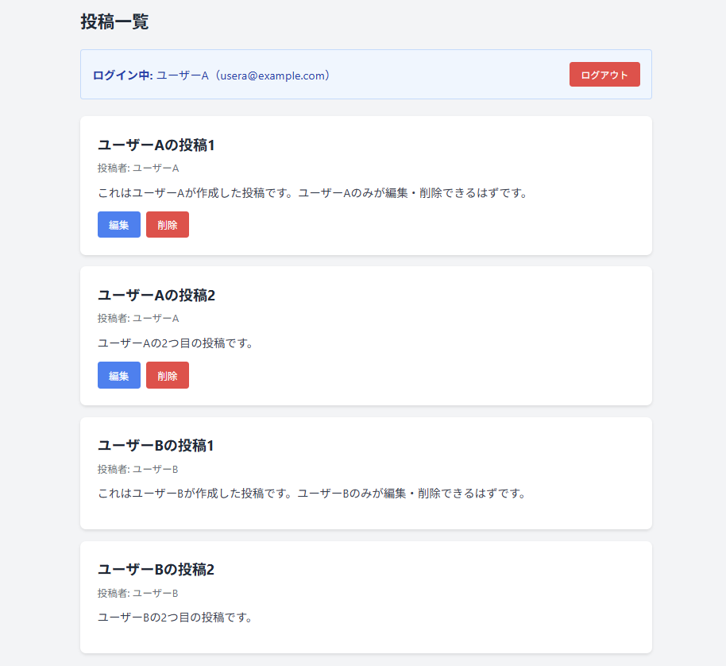
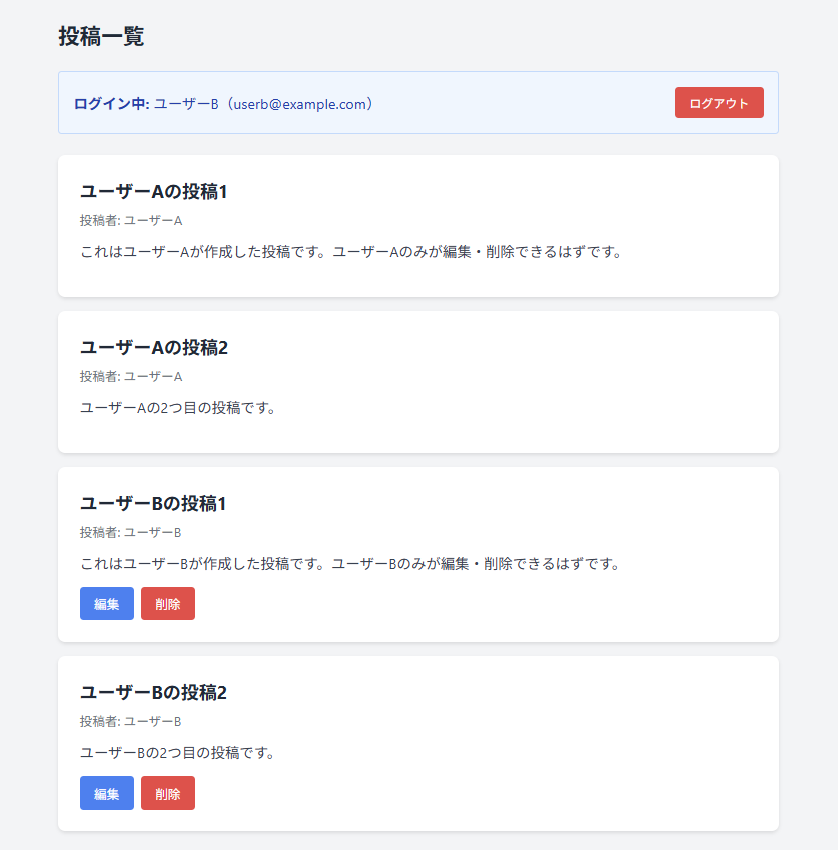
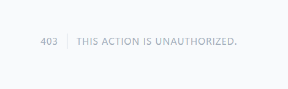

# authorization-app-practice

## 概要
COACHTECH 教材 Tutorial 10-3「認可機能 ハンズオン演習」で作成した成果物です。
投稿を作成した本人のみが投稿の編集・削除を行える認可機能を実装しました。

## 使用技術
- PHP 8.5.12
- Laravel 10.50.0
- Policy / Gate（認可）
- Laravel Fortify（認証）

## 学んだこと
- PolicyやGateによって認可（何ができるか）機能を実装する方法
- Policyクラスの作成とメソッドを定義し、モデルとPolicyクラスを関連付ける方法
- コントローラー内での $this->authorize() による認可判定と、Bladeの@canディレクティブによる認可判定を行う方法

## 動作確認
1. スターターキットをcloneする
2. authorization-app-practiceディレクトリ上でsail up -dコマンドによりyamlファイルに記述した構成通りのコンテナを起動させてネットワークで連携
3. sail artisan migrate --seedコマンドによりテーブルを作成して初期値を代入
4. ブラウザで「`http://localhost`」のURLにアクセスして以下のそれぞれの項目を確認
   - usera@example.com, password でログインし、ユーザーAの投稿のみに編集・削除ボタンが表示されることを確認
   - 他の人の投稿のURL（`http://localhost/posts/3/edit` など）を直接指定して編集・削除しようとすると403エラーになることを確認
   - userb@example.com, password でログインし、ユーザーBでも同様の確認を行う
5. 必要に応じてログアウトを行う

## 開発の工夫
- 今回は認可判定にて拒否された時に403エラー画面を表示させたいため、単にtrueかfalseを返すallows()などではなく、authorize()を活用して拒否されたときに自動的に403エラー画面を出すことで、コードの可読性を良くした

## 動作確認のスクリーンショット
1. ユーザーAでログインした時の投稿一覧画面

   

2. ユーザーBでログインした時の投稿一覧画面

   

3. 他のユーザーの投稿編集画面を開こうとした時のエラー画面

   